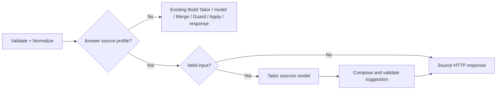

# Förberedd koppling till befintligt Tailor-workflow

2026-10-23, DEV-080. Ägaren valde ”Förbered riktig Tailor-koppling först”. Detta är en lokal, versionsbunden kandidat för godkännande. Ingen extern definition har skrivits, aktiverats eller publicerats. Ingen extern modell har körts. Den tidigare kandidatens källprofil, original/revisioner, granskning och Apply återanvänds.

## Exakt omfattning

Mål: befintliga `webflow-tailor-CV`, ID `H8oAioy58R1v3PvRe3YUa`, samma POST `/webhook/tailor-cv`. Sparad och aktiv version är båda `f399ee97-764b-44e0-bc42-5c7517499890`, updatedAt `2026-02-20T15:42:43.114Z`. Färsk GET bekräftade även att sparade/aktiva nodparametrar och kopplingar överensstämmer. Tidpunkt och checksummor finns i [manifestet](prepared/tailor-sources.release-manifest.json). En senare ändring kräver ny granskning; förberedaren stoppar vid annan version, noduppsättning, nodkod eller kopplingsgraf.

[Exakt lokal förberedare](../backend/n8n-tailor-sources-candidate.cjs) ändrar en befintlig nod: en villkorad inledning i `Validate + Normalize`. Den gamla valideringskoden behålls efter inledningen. Fem noder läggs till inom samma workflow:

- `Tailor has answer sources?` väljer källprofil om request innehåller något av de två nya fälten. Fel/okänd profil får inte falla tillbaka till vanlig Tailor.
- `Tailor source input valid?` skickar ogiltig request direkt till felsvar, utan modell.
- `Tailor sources model` använder befintlig modell/credential-referens och samma meddelandeuttryck. Separat nod behövs för att behålla den gamla modellnodens beteende och fullständig Responses-status på källvägen.
- `Compose source suggestion` tolkar exakt modell-JSON, kör samma deterministiska källkomposition som klienten, validerar hela förslaget och behåller källkvittot.
- `Respond with source suggestion` returnerar exakt CV-envelope med källutökning, eller sanerat felsvar med HTTP 400/413/422/503.



Den ursprungliga modellnoden och övriga nio befintliga noddefinitioner bevaras. Källvägen passerar inte den gamla Merge/Guard/Canonicalize-kedjan: den kedjan tillåter bara omformulering och skulle ta bort eller klippa tillägg och källkvitton. Backendens gamla nodnamn ”Apply” ändrar inte användarens CV; på den nya vägen sker ingen sådan versionsgenerering. Klientens Apply är fortfarande det enda steget som installerar förslaget i CV:t.

Den nya modellnoden föreslås använda `gpt-4.1-mini`, temperatur 0.2, högst 4000 output-tokens (vanliga vägen behåller 1200), `simplify:false`, `store:false`, inga verktyg och `retryOnFail:false`. Providerfel fortsätter till ett sanerat 503-svar. Avklippt/refuserad output, verktygsanrop, extra/okända fält, fel källa eller ogiltigt JSON ger 422 utan reparation eller ny modellkörning. Transportens interna retrybeteende är inte verifierat här. Parametrarna för raw Responses-output och tokenbegränsning stöds av [n8n:s officiella nodkälla](https://github.com/n8n-io/n8n/blob/master/packages/%40n8n/nodes-langchain/nodes/vendors/OpenAi/v2/actions/text/response.operation.ts); detta bevisar inte installerad Cloud-runtime eller faktisk modellkvalitet.

## Request, svar och källor

Ingen ytterligare API-utökning utöver den lokalt godkända [profil 1.0](../contracts/tailor-sources-v1.md) behövs för denna adapter. [Fullständiga request-/response-exempel](prepared/tailor-sources.examples.json) visar första förslaget och rättelse efter Apply. De åtta befintliga request-fälten utökas med exakt `sourcesSchemaVersion` och `sourceContext`. Den lyckade CV-responsen utökas med exakt sju fält:

```json
{
  "sourcesSchemaVersion": "1.0",
  "sourceContextRevision": "ctx-1",
  "sourceRoundId": "round-1",
  "sourceUsage": [{
    "applicationId": "tailor_12345_1",
    "blockId": "experience-1",
    "answerId": "a1",
    "answerRevision": 1,
    "sourceQuote": "At Example Studio, I planned a release with two developers.",
    "proposedQuote": "I planned a release with two developers.",
    "contextQuote": "At Example Studio, I planned a release with two developers."
  }],
  "sourceApplications": [{
    "blockId": "experience-1",
    "checkpointText": "Interviewed five users and shared their feedback.\n\nI planned a release with two developers.",
    "additions": [{
      "id": "tailor_12345_1",
      "start": 49,
      "end": 91,
      "text": "I planned a release with two developers.",
      "source": {
        "answerId": "a1",
        "answerRevision": 1,
        "sourceQuote": "At Example Studio, I planned a release with two developers."
      }
    }]
  }],
  "sourceReview": [],
  "contextQuestions": []
}
```

Det korta kvittoutdraget visar ett tillägg; de länkade fullständiga exemplen innehåller även hela CV-envelopen och flera källor. Registret har checkpoint, exakta intervall och beroende. Källans ID/revision/citat hålls åtskilda från föreslagen text. Modellens nya formulering är fortfarande ett granskningsförslag, aldrig användarbekräftad fakta.

Modellen får aktuella registrerade originalsvar och säkert CV/annonsunderlag. Rättade äldre svar, AI-tolkningar och gamla tilläggsregister blir inte nya faktakällor. Nej/överhoppningar/övriga osäkra tillstånd är begränsningar och kan inte stödja ett tillägg. Blandade svar behåller hela originalet och dess avgränsningar; instruktionen förbjuder att positiva utdrag tappar nekanden, intern/extern kontext eller personlig roll. Syntetiska tester visar bland annat intern workshopmedverkan utan kundansvar.

ID, revision, citat och stöd för placering kontrolleras maskinellt. Det är inte ett semantiskt bevis för varje omformulering: en modell kan ge fel innebörd trots ett riktigt citat. Därför visas original, kontext och förslag tillsammans före Apply. Verklig modellkvalitet och faktisk n8n-körning har inte testats, eftersom externa körningar inte är godkända.

Alla registrerade tillägg från en rättad källa räknas om, även efter flera Apply och i flera block. Nej/skip föreslår borttagning av säkert identifierbara tidigare tillägg, först efter granskning/Apply. Ändrade checkpoints eller osäker källa fryser berörda block oförändrade med granskningsmarkering. Ny anställning/projektidentitet skapas inte. Nytt block behöver först kontrakt för ID/metadata, placering, källberoenden, Apply och rättelser/borttagning; se profilens avsnitt om nya block.

Avgränsning som måste ingå i ett leveransgodkännande: källprofil 1.0 tillför och korrigerar källstödda tillägg i befintliga block. Den omformulerar inte samtidigt orelaterad befintlig CV-text. Den gamla CV/annons-vägen är bevarad. Att kombinera dess fria omformulering med källregistret i samma körning kräver ett separat preciserat kontrakt för textändringar och hur tidigare källintervall bevaras; det har inte smugit in här.

## Konkret diff och frontend

[Workflow-diffen](prepared/tailor-sources.workflow.diff.json) innehåller exakt före/efter för berörda parametrar och kopplingar. Den är ett granskningsunderlag, inte en PUT-payload. [Safe fixture](../tests/fixtures/tailor-workflow.safe.json) utelämnar credentials, settings, pin/static data och övrig metadata; den får inte användas för leverans eller rollback. Förberedaren kopierar däremot dessa fält från en framtida färsk fullständig definition i minnet. Credential-referensen ärvs från befintlig modell och skrivs inte i diffen.

[Separat frontend-patch](prepared/tailor-sources.frontend-enable.patch) ersätter localhost-begränsningen för exakt befintlig produktionsendpoint och behåller syntetisk preview. Patchen är kontrollerad men **inte applicerad**. Produktionsassets och deras ärliga CV/annons-text är oförändrade under denna förberedelse. Ett äldre backend-svar utan komplett giltigt källkvitto avvisas; ingen tyst fallback eller text som låtsas att svar har använts.

Lokal regenerering: `node tools/prepare-tailor-sources.cjs`. Inga nätverksanrop eller credentials används av det kommandot. Textchecksummor använder UTF-8 efter BOM-borttagning och LF-normalisering, så samma granskade kod kan verifieras även efter Windows/Linux-checkout. Det räcker inte att byta frontend-flagga: backend måste först stödja exakt samma profil.

## Lokal verifiering och preview

`node --test tests/n8n-tailor-sources.test.cjs` kör genererad nodkod, konfigurerade modelluttryck och nya routingvillkor i en lokal VM. Bland annat: versionsdrift, bevarad vanlig väg, credential/settings-bevarande, råa källor, fullständigt kvitto, nej/skip/blandade svar, saknat/nytt sammanhang, Unicode/gränser, providerfel, refusal/truncation, fel JSON/citat, flera Apply och fryst tidigare text. Ingen TextEncoder/crypto/import-global krävs i Code-noderna. Detta är en simulering av valda routingregler och Code-snuttar; det är inte n8n-motorn.

67 avgränsade unit/session/transport-tester passerar, inklusive nio nya adaptertester. Hela editorflödet har körts med `DRAFTED_PREVIEW_SCENARIO=sources-n8n`, där samma förberedda Code-snuttar och expressions används med syntetisk Responses-output. Frågor, kontextsvar, förslag i Experience/Community Project, granskning/Dismiss/Apply, flera rättelser, stale/dubbelstart, nej och ny-block-avgränsning fungerar lokalt. Browsertrafik utanför localhost blockeras i testet. Svaren påverkar förslaget; CV:t är oförändrat fram till Apply. Desktop/mobile-resultat har granskats visuellt; frontend-patchens tillämpbarhet, kodsyntax, artefaktchecksummor och kompletta exempel har kontrollerats.

Preview: http://127.0.0.1:8796/?sample=1. Starta annars med `PORT=8796` och `DRAFTED_PREVIEW_SCENARIO=sources-n8n` via `tools/serve-editor-preview.cjs`. Exempelsvar: ”At Example Studio, I planned a release with two developers.” och ”In Community Project, I helped facilitate two internal workshops. I did not lead customer sessions.” Prova sedan en rättelse till ”No”. `/preview-status` anger `prepared-code-local-simulation` och noll externa modellkörningar.

## Före en senare extern leverans

Nuvarande beslut gäller förberedelse. Separat konkret godkännande behövs för att skriva/publicera denna workflow-kandidat och därefter aktivera frontend/publicera PR #23. En sådan leverans ska följa EXECUTION-PLAYBOOK: färsk versionskontroll, komplett verifierad krypterad snapshot av sparat/aktivt, uttrycklig `publishIfActive=false` vid sparning, läs tillbaka både sparad och aktiv definition, och publicera endast den separat godkända versionen. Avbryt vid oväntad aktivering eller drift. Backendpublicering måste föregå frontend-patch, rebuild och Pages-merge. Inga andra workflows eller Webflow-sidor ingår. Externa modellkörningar är fortsatt uteslutna och kräver ett eget godkännande.
